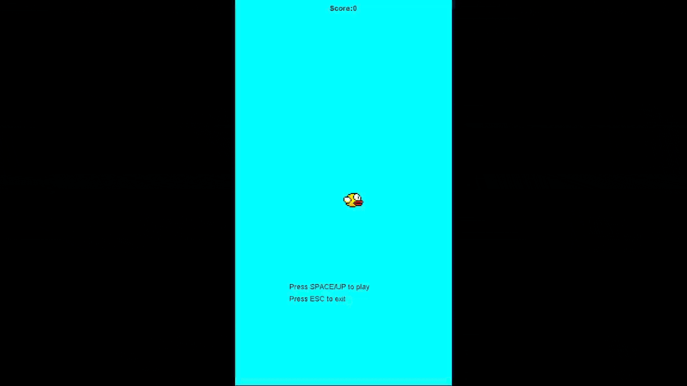

# TP6DPBO2526C1

## Janji
Saya Afif Fadilah Rahman dengan NIM 2508287 mengerjakan TP 6 dalam mata kuliah Desain Pemrograman Berbasis Objek untuk keberkahan-Nya maka saya tidak melakukan kecurangan seperti yang telah dispesifikasikan. Aamiin

## Desain program
Program ini menggunakan class untuk mendefinisikan masing-masing komponen java swing
serta komponen-komponen yang dibutuhkan untuk jalannya game.
Program memiliki class utama App yang berelasi Aggregasi dengan class Logic dan View,
Class View beraggregasi dengan class Logic, serta class Logic berelasi komposisi dengan Player, Pipe, dan Scorer.

## Penjelasan alur
Dalam program ini class App memiliki JFrame sebagai frame utama, kemudian menginstansiasi logic dan tampilan dan menambahkannya ke frame.
Class Logic menginstansiasi Player, Pipe, dan Scorer, serta menjalankan fungsi gravitasi, loncatan player, pergerakan pipa dan scorer.
Class View mengambil hasil instansiasi logic yang telah dilakukan untuk menggambar tampilan game.

## Dokumentasi

